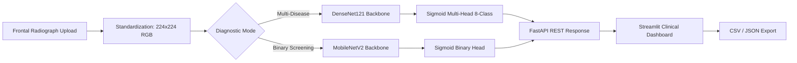

# 🩻 **HealthAI – AI-Powered Chest X-Ray Disease Detection System**

*A deep-learning medical imaging platform for multi-disease and binary pulmonary diagnosis, powered by DenseNet121, MobileNetV2, FastAPI, and Streamlit.*


---

## 🏷️ Tech Stack

<div align="center">


</div>

---

## 🚀 Overview

**HealthAI** is a clinical-grade medical imaging platform that analyzes **frontal chest radiographs (CXR)** using transfer learning convolutional neural networks. 

It provides two distinct diagnostic evaluation modes:
1. **Multi-Disease Analysis (DenseNet121)**: Predicts independent probabilities across 8 discrete pulmonary findings from the Stanford **CheXpert** dataset.
2. **Pneumonia Binary Screening (MobileNetV2)**: Rapid triage classifier determining whether a radiograph indicates **PNEUMONIA** vs. **NORMAL**.

The decoupled architecture consists of a high-throughput **FastAPI** inference microservice, deep learning models trained in **TensorFlow/Keras**, and a responsive **Streamlit** clinical dashboard with real-time risk stratification and adaptive Dark/Light theming.

---

## 🧠 Core Features

### 1. 🧬 Multi-Label Pathology Detection (CheXpert)
Computes probability scores across 8 pulmonary conditions:
- **Atelectasis**
- **Cardiomegaly**
- **Consolidation**
- **Edema**
- **Pleural Effusion**
- **Pneumonia**
- **Pneumothorax**
- **No Finding** (Normal baseline)

### 2. 🩺 Rapid Pneumonia Screening
- Instant binary classification (`NORMAL` vs `PNEUMONIA`).
- Calibrated confidence estimation and risk-tier tagging.

### 3. 🎨 Modern Clinical UI (Streamlit)
- **Adaptive Dark / Light Theming**: Seamless 1-click toggle with clinical-grade contrast.
- **Interactive Plotly Visualizations**: Color-coded horizontal probability spectrum (Green: Low Risk, Amber: Moderate, Red: High Risk).
- **Audit Reports**: Instant report downloads in both **CSV** and **JSON** formats.
- **Auto-Detect Backend**: Automatically connects to local backend (`http://127.0.0.1:8000`) or falls back to cloud deployment.

---

## 🏗️ Architecture & Pipeline



---

## 📁 Project Structure

```
HealthAI-Project/
│
├── backend/
│   ├── main.py                  # FastAPI inference endpoints & model handlers
│   └── requirements.txt         # Backend Python dependencies
│
├── dashboard/
│   ├── app.py                   # Streamlit clinical dashboard with Dark/Light mode
│   ├── requirements.txt         # Dashboard dependencies (Streamlit, Plotly, Pandas)
│   └── .streamlit/
│       └── config.toml          # Dashboard theme configuration
│
├── models/
│   ├── xray_chexpert_multidisease_model.h5   # DenseNet121 multi-disease weights
│   ├── xray_chexpert_labels.json            # 8 CheXpert disease labels
│   ├── xray_disease_model.h5                # MobileNetV2 pneumonia binary weights
│   └── xray_class_mapping.json              # Binary class mapping (NORMAL / PNEUMONIA)
│
├── notebooks/
│   ├── 01_xray_disease_detection.ipynb      # Training & evaluation pipeline (MobileNetV2)
│   └── 02_xray_chexpert_multidisease.ipynb  # Training & evaluation pipeline (DenseNet121)
│
├── screenshots/                 # UI screenshots and visual assets
├── .gitignore
├── LICENSE                      # MIT License
└── README.md
```

---

## 📊 Verified Model Specifications

All metrics below are verified directly from training checkpoints and evaluation runs in the `notebooks/` directory:

| Specification | Multi-Disease Model | Pneumonia Screening Model |
| :--- | :--- | :--- |
| **Model Artifact** | `xray_chexpert_multidisease_model.h5` | `xray_disease_model.h5` |
| **Base Architecture** | **DenseNet121** (ImageNet pre-trained) | **MobileNetV2** (ImageNet pre-trained) |
| **Head Architecture** | `GlobalAvgPool2D → Dropout → Dense(8, sigmoid)` | `GlobalAvgPool2D → Dropout(0.3) → Dense(1, sigmoid)` |
| **Dataset** | Stanford CheXpert (`CheXpert-v1.0-small`) | Kaggle Chest X-Ray (Pneumonia) |
| **Input Dimensions** | `(224, 224, 3)` | `(224, 224, 3)` |
| **Loss Function** | `binary_crossentropy` | `binary_crossentropy` |
| **Optimizer** | `Adam(learning_rate=1e-4)` | `Adam(learning_rate=1e-3)` |
| **Validation Loss** | **`0.3939`** | **`0.2730`** |
| **Validation Accuracy** | **`29.06%`** (Exact multi-label match) | **`87.82%`** |

---

## 📡 API Endpoints Reference

The FastAPI service exposes the following endpoints:

| Method | Endpoint | Description | Payload |
| :--- | :--- | :--- | :--- |
| **`POST`** | `/predict-xray-multidisease` | Predicts probabilities for 8 conditions | Multipart `file` (JPG/PNG) |
| **`POST`** | `/predict-xray` | Predicts binary Pneumonia vs Normal | Multipart `file` (JPG/PNG) |
| **`GET`** | `/health` | Service health status check | None (returns `{"status":"ok"}`) |
| **`GET`** | `/version` | Deployment version check | None (returns `{"version":"..."}`) |
| **`GET`** | `/docs` | Interactive Swagger UI API explorer | Web Browser |

### Example Request (`curl`)
```bash
curl -X POST "http://127.0.0.1:8000/predict-xray-multidisease" \
     -F "file=@sample_chest_xray.jpg"
```

### Example Response
```json
{
  "predictions": {
    "Atelectasis": 0.3679,
    "Cardiomegaly": 0.1824,
    "Consolidation": 0.2415,
    "Edema": 0.2717,
    "Pleural Effusion": 0.3617,
    "Pneumonia": 0.0894,
    "Pneumothorax": 0.0512,
    "No Finding": 0.0489
  },
  "top3": [
    {"label": "Atelectasis", "probability": 0.3679},
    {"label": "Pleural Effusion", "probability": 0.3617},
    {"label": "Edema", "probability": 0.2717}
  ]
}
```

---

## 💻 How to Run Locally

### 1️⃣ Clone and Set Up Virtual Environment

```bash
git clone https://github.com/AKHIL-SAURABH/HealthAI-Project.git
cd HealthAI-Project

# Create virtual environment with Python 3.10
python3.10 -m venv venv
source venv/bin/activate
```

### 2️⃣ Install Dependencies

```bash
# Install backend dependencies
pip install -r backend/requirements.txt

# Install dashboard dependencies
pip install -r dashboard/requirements.txt
```

---

### 3️⃣ Start the FastAPI Backend

In your first terminal, run:

```bash
cd backend
../venv/bin/uvicorn main:app --reload --host 0.0.0.0 --port 8000
```

- **Backend Health**: [http://127.0.0.1:8000/health](http://127.0.0.1:8000/health)
- **Interactive Swagger Docs**: [http://127.0.0.1:8000/docs](http://127.0.0.1:8000/docs)

---

### 4️⃣ Start the Streamlit Dashboard

In a second terminal, run:

```bash
cd dashboard
../venv/bin/streamlit run app.py
```

- **Dashboard UI**: [http://localhost:8501](http://localhost:8501)

*The dashboard automatically connects to your local backend on port `8000`.*

---

## ⚖️ Clinical Safety Disclaimer

> [!WARNING]
> **Investigational Use Only**: HealthAI is designed as an AI decision-support and educational tool. The computed probabilities are statistical estimations and **must never replace clinical diagnosis** or the expert interpretation of a licensed medical practitioner or radiologist.

---

## 📄 License

This project is licensed under the [MIT License](LICENSE).

---
